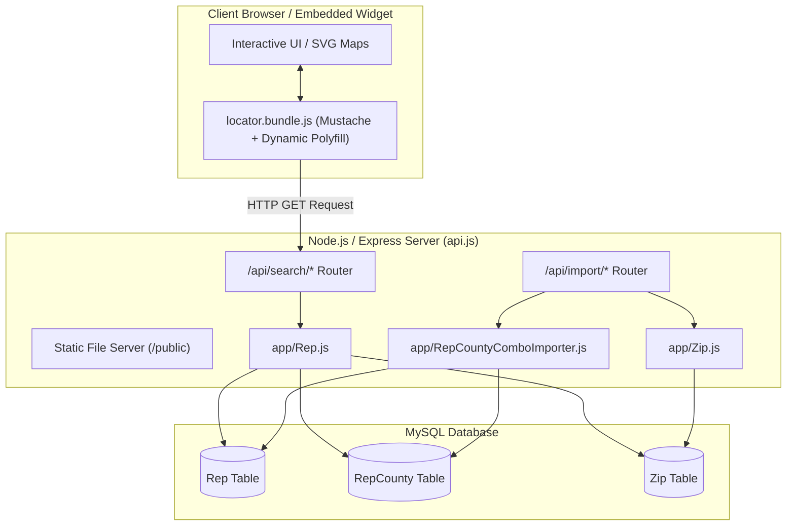

# Robroy Rep Locator - Agent Documentation & Process Guide

## 1. Project Overview

**Robroy Rep Locator** is a full-stack web application and embeddable locator widget developed for Robroy Industries brands (such as Plasti-Bond, Stahlin, Attabox, Rocket Rack, etc.). It enables customers, distributors, and internal users to locate sales representatives and agencies by brand and geographical criteria (Country, State, County, and Zip Code), accompanied by interactive US and World SVG maps.

### Core Capabilities
- **Multi-Brand Support**: Dynamic filtering across brands (`RR`, `PM`, `ST`, `AT`, `PB`, `RS`, etc.).
- **Hierarchical Geographic Filtering**: Country &rarr; State &rarr; County &rarr; Zip Code.
- **Interactive SVG Map Integration**: Clickable US map states and World map display for non-US countries.
- **Embeddable Client Widget**: Pre-bundled JavaScript widget (`public/locator.bundle.js`) customizable with Mustache.js templates.
- **Bulk Data Import**: Direct CSV data ingestion into MySQL using high-performance `LOAD DATA LOCAL INFILE` queries.

---

## 2. System Architecture & Component Interactions



---

## 3. Directory Structure

```
Robroy-Rep-Locator/
├── api.js                                     # Express server entry point & static hosting
├── package.json                               # Dependencies and build scripts
├── example.env                                # Sample environment variables configuration
├── database.sql                               # Base MySQL database schema definition
├── migrations/                                # SQL migration scripts
│   └── 20200117_db_migration_update_unique_key.sql
├── app/                                       # Core data models and business logic
│   ├── Rep.js                                 # Rep query builder and resolver logic
│   ├── RepCounty.js                           # RepCounty domain entity representation
│   ├── RepCountyComboImporter.js              # CSV bulk import logic for Rep & RepCounty
│   └── Zip.js                                 # Zip code database model & importer
├── routes/                                    # Express API route handlers
│   ├── Search.js                              # Search & geographic metadata API endpoints
│   └── Import.js                              # Administrative CSV import triggers
├── utils/                                     # Utility modules
│   └── mysql.js                               # MySQL2 connection pool promise wrapper
├── client/                                    # Client-side source code
│   └── locator.js                             # Locator widget core frontend script
├── public/                                    # Public assets & HTML integration demos
│   ├── index.html                             # Default root page
│   ├── plastibond.html                        # Plasti-Bond locator integration demo
│   ├── stahlin.html                           # Stahlin locator integration demo
│   ├── example/                               # Map assets, state TSV/JSON definitions
│   └── locator.bundle.js                      # Compiled client bundle (generated)
└── lando/                                     # Local development container configuration
    └── nginx.conf                             # Nginx reverse proxy configuration
```

---

## 4. Database Schema & Data Models

The database consists of three primary tables in MySQL (`latin1` / `utf8` charset):

### 1. `Rep` Table
Stores contact information for sales representatives and agencies.
- `rep_code` (VARCHAR(11), PRIMARY KEY): Unique representative identifier code.
- `brand` (VARCHAR(255), NOT NULL): Brand code associated with the representative.
- `agency` (VARCHAR(255)): Agency or distributor name.
- `contact` (VARCHAR(255)): Principal contact person name.
- `address`, `city`, `state`, `zip`, `country`: Physical location of the agency.
- `phone`, `fax`, `email`: Contact channels.

### 2. `RepCounty` Table
Maps sales representatives to assigned geographic territories (counties, states, countries) per brand.
- `county` (VARCHAR(255), NOT NULL): County name.
- `state` (VARCHAR(255), NOT NULL): Full state name.
- `state_abbr` (VARCHAR(4)): Two-letter state abbreviation.
- `country` (VARCHAR(255)): Country name (e.g., `USA`, `Canada`, etc.).
- `territory_id` (INT(11)): Numeric territory identifier.
- `territory_name` (VARCHAR(255)): Territory name/region (e.g., `Western`, `Midwest`).
- `brand` (VARCHAR(255), NOT NULL): Brand code (e.g., `PB`, `ST`, `RS`).
- `rep_code` (VARCHAR(11), NOT NULL): Foreign key reference to `Rep.rep_code`.
- `notes` (TEXT): Special territory notes or coverage instructions.
- **Unique Constraint**: `UNIQUE KEY (county, state, brand, rep_code)`

### 3. `Zip` Table
Lookup table for US 5-digit zip codes to map zip code input to County and State.
- `zip` (VARCHAR(255), NOT NULL): 5-digit US Postal zip code.
- `county` (VARCHAR(255), NOT NULL): Associated county name.
- `state` (VARCHAR(255), NOT NULL): Associated two-letter state abbreviation.
- **Unique Constraint**: `UNIQUE KEY (zip, county, state)`

---

## 5. API Reference & Request Lifecycle

All endpoints are hosted under `/api`.

### Search Endpoints (`routes/Search.js`)

#### 1. `GET /api/search/reps_by_location`
Queries and returns distinct representatives matching the provided location criteria.
- **Query Parameters**:
  - `brand` *(required)*: Brand code (e.g., `ST`, `PB`, `RS`).
  - `country` *(optional)*: Country name (e.g., `USA`). Auto-resolved if brand is single-country.
  - `state` *(optional)*: Two-letter state abbreviation (e.g., `TX`, `CA`).
  - `county` *(optional)*: County name prefix (searches with prefix wildcard `LIKE 'county%'`).
  - `zip` *(optional)*: 5-digit Zip code (executes an `INNER JOIN Zip` on county and state).
- **Execution Strategy**:
  ```sql
  SELECT DISTINCT 
    Rep.rep_code, Rep.agency, Rep.contact, Rep.address, Rep.city,
    Rep.state, Rep.zip, Rep.phone, Rep.fax, Rep.email, Rep.country, RepCounty.notes
  FROM RepCounty
  [INNER JOIN Zip ON RepCounty.county = Zip.county AND RepCounty.state_abbr = Zip.state]
  INNER JOIN Rep ON RepCounty.rep_code = Rep.rep_code
  WHERE RepCounty.brand = ? AND Rep.brand = ? [AND conditions...]
  ```

#### 2. `GET /api/search/countries`
- **Query Parameters**: `brand` *(required)*
- **Returns**: Distinct list of countries available for the specified brand (`[{ country: "USA", abbr: "USA" }]`).

#### 3. `GET /api/search/states`
- **Query Parameters**: `brand` *(required)*, `country` *(optional)*
- **Returns**: Distinct list of states and abbreviations for the specified brand and country.

#### 4. `GET /api/search/counties`
- **Query Parameters**: `brand` *(required)*, `country` *(optional)*, `state` *(required)*
- **Returns**: Distinct list of counties for the given state and brand.

---

### Import Endpoints (`routes/Import.js`)

#### 1. `GET /api/import/zip`
- Truncates `Zip` table and ingests `import/zips.csv` via MySQL `LOAD DATA LOCAL INFILE`.

#### 2. `GET /api/import/repcountycombo`
- **Query Parameters**:
  - `file` *(optional)*: CSV filename located inside `import/{file}.csv`.
  - `append` *(optional)*: If set, does not truncate `Rep` and `RepCounty` tables before importing.
  - `table` *(optional)*: Pre-existing database table to import from instead of CSV file.
- **Process Flow**:
  1. Creates temporary table `temp_import`.
  2. Executes `LOAD DATA LOCAL INFILE` into `temp_import`.
  3. Inserts distinct reps into `Rep`.
  4. Inserts territory mappings into `RepCounty`.
  5. Drops `temp_import`.

---

## 6. Client-Side Widget Architecture (`client/locator.js`)

The client-side module provides a self-contained widget under `window.repLocator`.

```mermaid
sequenceDiagram
    participant User
    participant Widget as window.repLocator
    participant API as /api/search/*
    
    User->>Widget: Loads page with repLocator.init(config)
    Widget->>API: GET /api/search/countries?brand=...
    API-->>Widget: Returns country list
    alt Single Country or Default USA
        Widget->>API: GET /api/search/states?brand=...&country=USA
        API-->>Widget: Returns states list
        Widget->>Widget: Populates state <select> dropdown
    end
    
    User->>Widget: Selects State OR Clicks SVG Map State OR Types County/Zip
    Widget->>API: GET /api/search/reps_by_location?brand=...&state=...&county=...&zip=...
    API-->>Widget: Returns Rep records
    Widget->>Widget: Renders resultsBox using Mustache.js repTemplate
    Widget->>Widget: Formats phone & fax as clickable tel: links
    Widget-->>User: Displays Rep Cards
```



### Key Client Features:
1. **URL Parameter Pre-Population**:
   - Supports deeplinking with `?country=...&state=...&county=...&zip=...`.
   - Pre-fills input fields and triggers search automatically on initialization.
2. **Debounced Text Inputs**:
   - County and Zip inputs are debounced by 500ms to avoid overwhelming the server with rapid keystrokes.
3. **SVG Map Synchronization**:
   - Listens to clicks on SVG state elements (`path` or `text` tags within `<g class="XX">`).
   - Automatically populates the state dropdown and dispatches search queries.
4. **Conditional Map Display**:
   - Shows US SVG Map when country is `USA`.
   - Hides county/zip search fields and toggles World SVG Map when a non-US country is selected.
5. **Template Rendering & Phone Link Formatter**:
   - Evaluates custom Mustache.js markup supplied via `repTemplate`.
   - Converts plaintext phone and fax numbers into clickable `tel:+1234567890` anchors.

---

## 7. Environment Setup & Configuration

### Environment Variables (`.env`)
Create a `.env` file based on `example.env`:

```ini
LOCATOR_API_DOMAIN=http://replocator.lndo.site   # Base URL for API calls from client widget
LOCATOR_API_PORT=80                              # Node.js listening port
MYSQL_HOST=db                                    # MySQL host
MYSQL_PORT=3306                                  # MySQL port
MYSQL_USER=mysql                                 # MySQL username
MYSQL_PASSWORD=password                          # MySQL password
MYSQL_DATABASE=database                          # MySQL database name
```

### Installation & Development Workflow

1. **Install Dependencies**:
   ```bash
   npm install
   ```

2. **Database Initialization**:
   Import `database.sql` into your MySQL instance:
   ```bash
   mysql -u mysql -p database < database.sql
   mysql -u mysql -p database < migrations/20200117_db_migration_update_unique_key.sql
   ```

3. **Build Frontend Bundle**:
   To recompile `client/locator.js` into `public/locator.bundle.js`:
   ```bash
   npm run build-client
   ```

4. **Start Application Server**:
   ```bash
   npm start
   ```

---

## 8. Integration Example for External Websites

To integrate the locator widget into any webpage:

```html
<!-- Load Dependencies & Bundle -->
<script src="//code.jquery.com/jquery-1.11.0.min.js"></script>
<script src="/locator.bundle.js"></script>

<!-- Container Markup -->
<div id="replocator">
  <div id="locator-map"><!-- SVG US Map --></div>
  <div id="locator-world-map"><!-- Optional SVG World Map --></div>

  <form id="locator-search">
    <select id="locator-country" name="country"></select>
    <select id="locator-state" name="state"></select>
    <input id="locator-county" name="county" placeholder="County">
    <input id="locator-zip" name="zip" placeholder="Zip Code">
    <button id="form-reset">Reset</button>
  </form>

  <div id="locator-results"></div>
</div>

<script>
  window.onload = function() {
    repLocator.init({
      brand: 'PB', // Brand code: PB, ST, RS, RR, etc.
      map: document.getElementById('locator-map'),
      worldMap: document.getElementById('locator-world-map'),
      countryInput: document.getElementById('locator-country'),
      stateInput: document.getElementById('locator-state'),
      countyInput: document.getElementById('locator-county'),
      zipInput: document.getElementById('locator-zip'),
      resetForm: document.getElementById('form-reset'),
      resultsBox: document.getElementById('locator-results'),
      repTemplate: `
        <div class="rep-card">
          <h3>{{agency}}</h3>
          <p><strong>Contact:</strong> {{contact}}</p>
          <p><strong>Email:</strong> <a href="mailto:{{email}}">{{email}}</a></p>
          <p><strong>Address:</strong> {{address}}, {{city}}, {{state}} {{zip}}</p>
          <p class="phone"><strong>Phone:</strong> <a>{{phone}}</a></p>
          <p class="fax"><strong>Fax:</strong> <a>{{fax}}</a></p>
          {{#notes}}<p class="notes">{{notes}}</p>{{/notes}}
        </div>
      `,
      fallbackTemplate: '<div class="no-rep">Please contact factory customer support.</div>'
    });
  };
</script>
```

---

## 9. Maintenance & Troubleshooting Guide

| Issue | Probable Cause | Resolution |
| :--- | :--- | :--- |
| **CORS Errors during search** | `LOCATOR_API_DOMAIN` mismatch or client calling a different domain. | Verify `.env` file settings and ensure `cors` middleware in `api.js` permits the requesting origin. |
| **`LOAD DATA LOCAL INFILE` fails on import** | MySQL server disables local infile capability by default. | Ensure MySQL server and client are configured with `local_infile=1`. |
| **Client JS updates not appearing** | Browser cache or `public/locator.bundle.js` was not rebuilt. | Run `npm run build-client` after editing `client/locator.js`. |
| **Missing reps when querying by Zip** | Zip code not present in `Zip` table. | Import updated `zips.csv` via `/api/import/zip`. |
| **Non-US countries not displaying states** | State records in `RepCounty` have blank `country` or state codes. | Verify `RepCounty.country` values and re-run import with country codes populated. |
